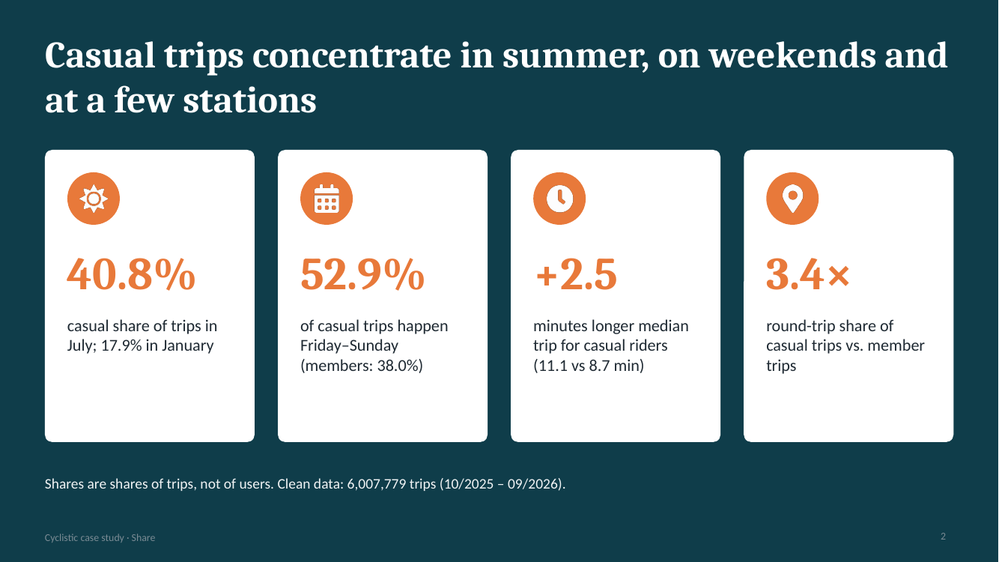
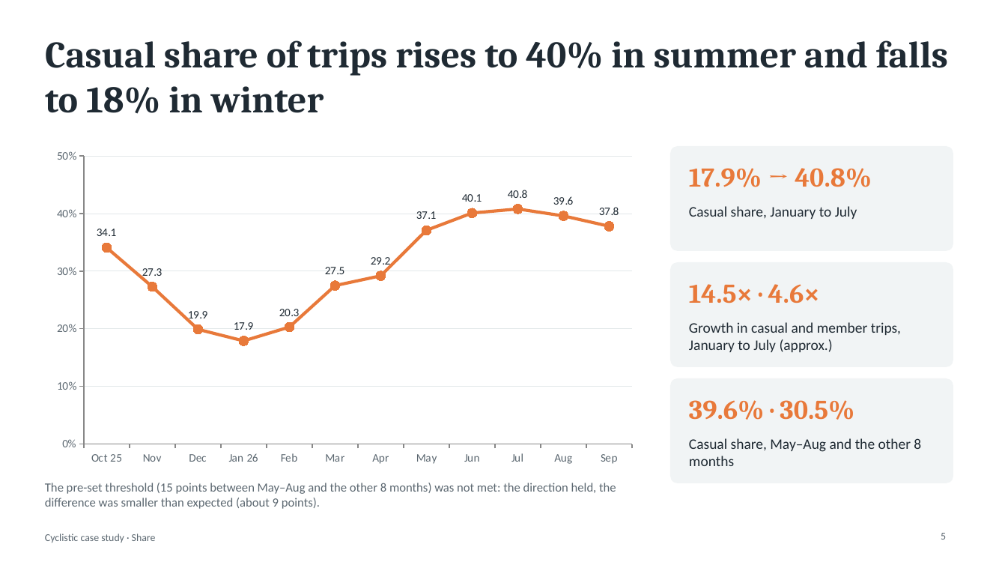
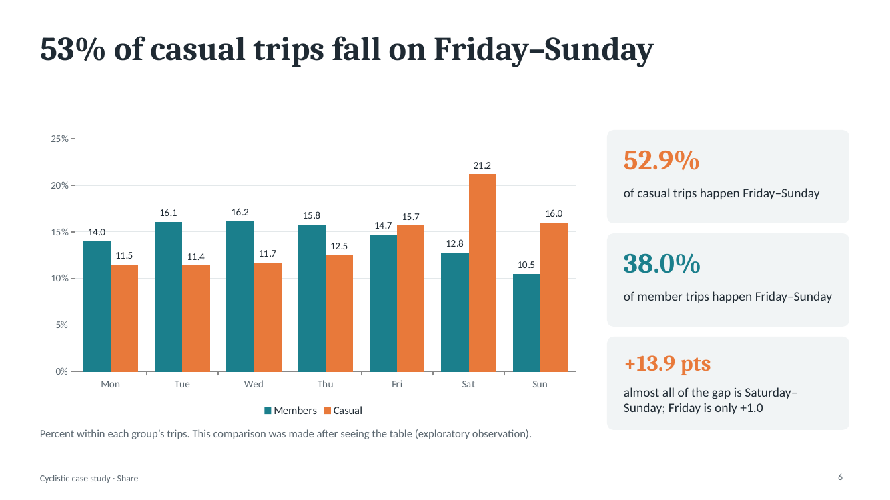
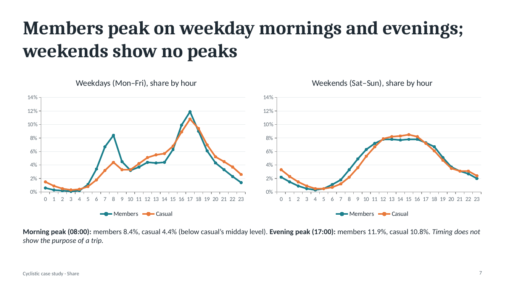
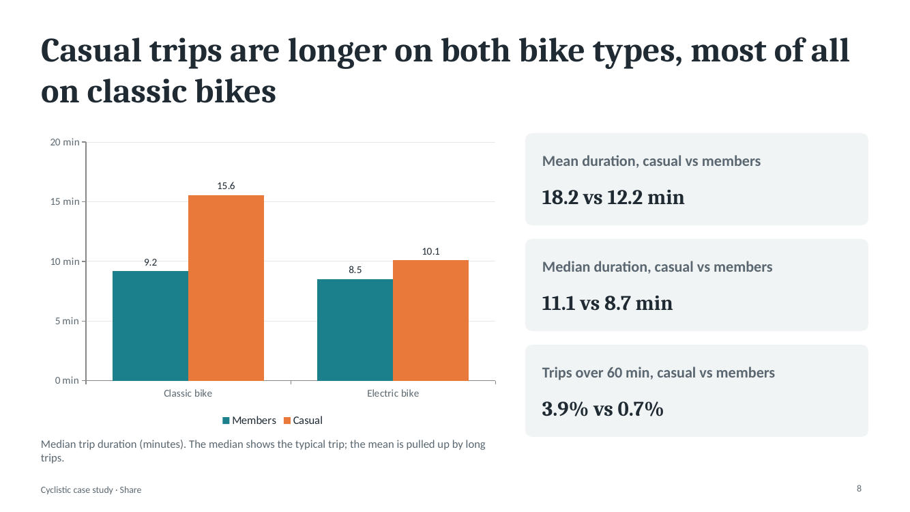
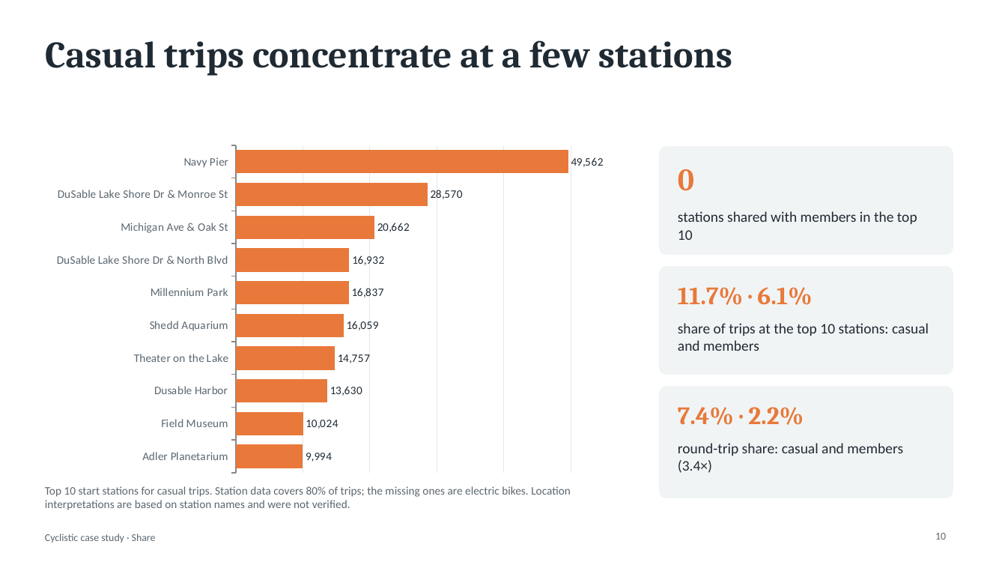

# Cyclistic Bike-Share Case Study

**How do annual members and casual riders use Cyclistic bikes differently?**

A capstone-style analysis of 12 months of bike-share trips (October 2025 – September 2026), done in MySQL. The goal is to give a marketing team evidence for converting casual riders into annual members.

> Cyclistic is a fictional company. The data comes from Divvy, a real bike-share system in Chicago, and is published under Motivate International Inc.'s data license (see [Divvy system data](https://divvybikes.com/system-data)).

📄 **Slides:** [`reports/cyclistic_share_en.pdf`](reports/cyclistic_share_en.pdf) (editable source: [`.pptx`](reports/cyclistic_share_en.pptx))

---

## Short answer

Casual trips concentrate in **summer**, on **weekends** and at **a few stations**; member trips peak on **weekday mornings and evenings**.

| Finding | Casual | Members |
|---|---|---|
| Share of own trips on Friday–Sunday | 52.9% | 38.0% |
| Median trip duration | 11.1 min | 8.7 min |
| Electric bike share of own trips | 74.2% | 68.3% |
| Round-trip share (same start and end station) | 7.42% | 2.21% (casual is 3.4×) |

Casual riders account for 17.9% of all trips in January and 40.8% in July.

All figures are **shares of trips, not of users**: the data has no user IDs.



## Key findings

### Seasonality
Casual share of trips climbs from 17.9% in January to 40.8% in July. Casual trips grew about 14.5× from January to July (approx.), member trips about 4.6×. No weather data was available, so the pattern is described as "higher in warm months", not "because of temperature".



### Day of week and hour of day
Casual riders ride more on weekends (the gap comes almost entirely from Saturday–Sunday). Members show clear weekday morning and evening peaks; weekends show no peaks. Casual riders also peak in the evening, but their morning peak is weak. Timing does not show the *purpose* of a trip.




### Trip duration and bike type
Casual trips are longer on both bike types (medians: classic 15.6 vs 9.2 min, electric 10.1 vs 8.5 min). Casual riders use electric bikes more in every month of the year. Bike type alone does not explain the duration gap.



### Stations
Casual trips concentrate at a few stations; the top 10 casual start stations share no station with the members' top 10. Station data covers about 80% of trips (the rest are electric bikes with no station recorded), so this is read as an exploratory observation.



## Recommendations (to be tested with pilots)

1. **Test a weekend or seasonal membership.** Evidence: 52.9% of casual trips are Friday–Sunday; share varies 17.9%–40.8% by month.
2. **Pilot a campaign at busy casual stations.** Evidence: top 10 stations hold 11.7% of casual trips; round-trip share is 3.4× the members'.
3. **Start campaigns before summer.** Evidence: casual share is 27–29% in March–April and 37% in May.

The data shows where testing makes sense; only a pilot shows whether a campaign works.

## Method

**Process:** Ask → Prepare → Process → Analyze → Share → Act.

- **Preparation:** 12 monthly tables loaded into MySQL. Dates arrived as text and were converted to `datetime`; empty strings were turned into `NULL`.
- **Cleaning (every step logged):** 6,171,785 raw rows → 6,007,779 clean rows (164,006 removed, about 2.66%): 71 out-of-period rows, 35 exact duplicates (same `ride_id`), 163,900 trips shorter than 60 seconds or longer than 24 hours. Rows with missing station info were kept.
- **Hypotheses:** hypotheses, thresholds and refutation conditions were written **before** running queries. Findings written after seeing results are marked *exploratory*.

| Hypothesis (written beforehand) | Result |
|---|---|
| Casual share is higher May–Aug than in the other 8 months, by at least 15 points | Not supported: direction held, difference about 9 points |
| Members show weekday morning and evening peaks; casual riders do not | Members: supported. Casual: refuted (casual also shows two peaks, the morning one is weak) |
| Casual round-trip share is at least 1.5× the members' | Supported (3.4×) |
| Casual round-trip top 10 stations overlap with casual top 10 by at least 5 stations | Supported (8 of 10) |

The Friday–Sunday comparison and the station lists were made after seeing the data (exploratory).

## Limitations

- **Trips, not users.** No user IDs; the same person may account for many trips.
- **One year, no weather data.**
- **Station coverage is about 80%;** missing stations are all electric bikes, so station results may skew toward classic bikes.
- **The duration filter was uneven:** about 3.6% of casual trips and 2.1% of member trips were removed (approximate).
- **Purpose and conversion likelihood are not in the data.**
- Bike type and season were not controlled together.

## Repository structure

```
.
├── README.md
├── reports/        slides (PDF + PPTX)
├── images/         charts used in this README
├── sql/            analysis queries, run in order (see below)
└── docs/           cleaning log
```

### SQL files

File names and comments are in Turkish. Run in this order:

| File | Purpose |
|---|---|
| `01_profil_ve_kontrol.sql` | Profile the monthly tables (counts, column types) |
| `02_tarih_dogrulama.sql` | Check that text timestamps convert to dates |
| `03_tarih_araligi.sql` | Check date ranges and month-boundary overlaps |
| `04_eksik_istasyon.sql` | Missing station and coordinate checks |
| `05_tripdata_all_olustur.sql` | Combine monthly tables into `tripdata_all` and verify |
| `06_yinelenen_ride_id.sql` | Duplicate trip IDs |
| `07_sure_kontrolu.sql` | Very short and very long trips |
| `08_tripdata_clean_olustur.sql` | Build `tripdata_clean` |
| `09_mevsim_ve_yolculuk_payi.sql` | Seasonality |
| `10_yolculuk_suresi.sql` | Trip duration (mean, median) |
| `11_gun_ve_saat.sql` | Day of week and hour of day |
| `12_bisiklet_tipi.sql` | Bike type |
| `13_istasyonlar.sql` | Stations and round trips |

## Notes

- **Data is not included** in this repository. Download the monthly Divvy trip files from the link above.
- **AI use:** the SQL was developed together with an AI assistant. Hypotheses, thresholds and decisions were set before running the queries, and results were verified with row totals and cross-checks.
